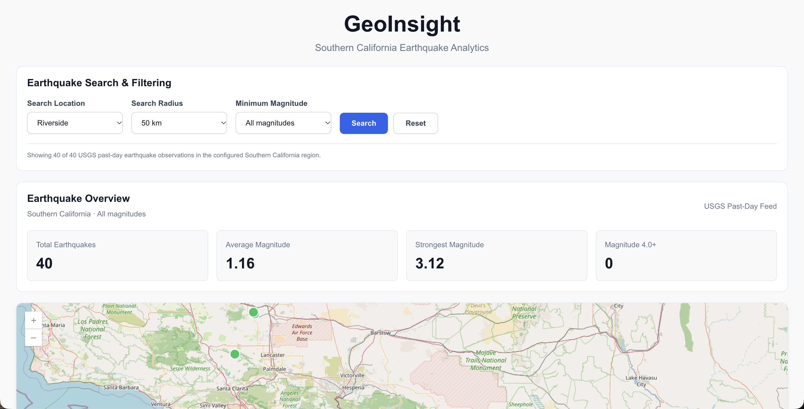
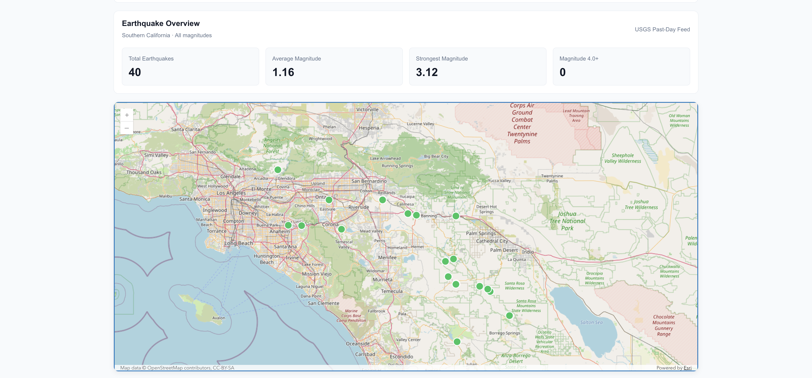
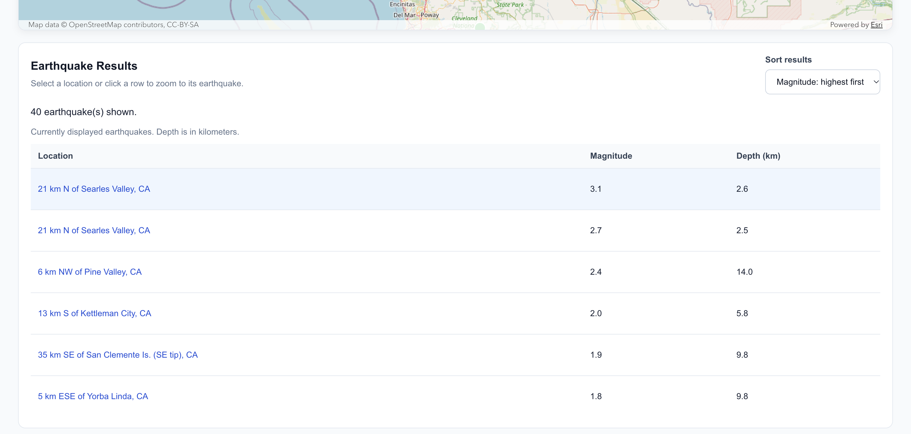

# GeoInsight

**Interactive Earthquake Visualization and Geospatial Analytics**

GeoInsight is a web-based Geographic Information System (GIS) application for exploring earthquake activity across Southern California and surrounding areas. Built with React, TypeScript, and Esri's ArcGIS Maps SDK for JavaScript, it combines earthquake observations from the U.S. Geological Survey (USGS) with interactive mapping, geographic searches, magnitude filtering, and statistical analysis.

The application allows users to explore earthquake activity geographically, examine individual earthquake observations, perform radius-based spatial searches, and analyze seismic activity through an interactive dashboard.

GeoInsight demonstrates practical applications of geospatial computing, third-party API integration, frontend development, spatial algorithms, and automated software testing.

Developed collaboratively by **Christopher Dodge and Caleb Sandoval**.

**Repository:** https://github.com/Chris-Dodge1/geoinsight

---

## Screenshots

### Earthquake Search and Analytics Dashboard

The GeoInsight dashboard provides geographic search controls and dynamically calculated earthquake statistics.

Users can select search locations, configure search radii, and filter observations based on magnitude.



### Interactive ArcGIS Earthquake Map

GeoInsight visualizes earthquake locations using the ArcGIS Maps SDK for JavaScript.

Earthquake markers are displayed using magnitude-based symbology, allowing users to distinguish seismic activity geographically.

Users can zoom, pan, select earthquake markers, and explore earthquake information through interactive popups.



### Interactive Earthquake Results

The earthquake results table displays observations corresponding to the current map filters.

Users can sort earthquakes by magnitude, depth, or location and select individual observations to navigate directly to their positions on the ArcGIS map.



---

## Features

### Interactive Earthquake Map

GeoInsight provides an interactive geographic visualization of earthquake observations across Southern California.

- Visualizes earthquake locations using ArcGIS `GraphicsLayer` and geographic coordinates.
- Creates interactive earthquake markers with `Graphic` and `Point` geometries.
- Applies magnitude-based marker colors to distinguish earthquake intensity.
- Displays earthquake information through interactive ArcGIS popups.
- Provides earthquake location, magnitude, and depth information.
- Supports map navigation, zooming, and geographic exploration.
- Updates earthquake markers when users change their search criteria.

Earthquake markers are categorized using the following magnitude ranges:

| Magnitude | Marker Color |
|---|---|
| Below 2.5 | Green |
| 2.5–3.9 | Orange |
| 4.0 and above | Red |

These ranges are visualization categories used by GeoInsight.

### Geographic Radius Search

The geographic search functionality allows users to identify earthquake observations within a specified distance of a selected location.

Supported search locations include:

- Riverside, California
- Redlands, California
- Palm Springs, California

Available search distances are **25 km, 50 km, and 100 km**.

GeoInsight uses ArcGIS geodetic distance calculations to determine whether individual earthquake observations fall within the selected search radius.

The application also generates a visual search boundary using a geodesic buffer.

Key capabilities include:

- Geographic distance calculations using ArcGIS geometry operators.
- Radius-based filtering of earthquake observations.
- Geographic search boundary visualization.
- Integration with existing earthquake magnitude filters.
- Synchronization between search results, the map, and the analytics dashboard.
- Reset functionality to remove the geographic search while retaining the selected magnitude filter.

### Magnitude Filtering

GeoInsight allows users to filter earthquake observations according to their magnitude.

Available filtering options include:

- All magnitudes
- Magnitude 2.5+
- Magnitude 4.0+

Magnitude filters can be combined with geographic radius searches to narrow the displayed observations.

When a magnitude filter changes, GeoInsight automatically updates:

- Earthquake markers on the ArcGIS map.
- Earthquake analytics dashboard statistics.
- Earthquake results displayed in the table.
- The current number of matching observations.

Filtering operates on the application's loaded earthquake dataset without requiring a new USGS API request for each change.

### Earthquake Analytics Dashboard

The GeoInsight analytics dashboard summarizes earthquake activity using the currently filtered observations.

The dashboard displays four primary statistics:

| Statistic | Description |
|---|---|
| Total Earthquakes | Number of earthquake observations matching the active filters |
| Average Magnitude | Arithmetic mean magnitude of matching observations |
| Strongest Magnitude | Maximum observed magnitude within the filtered dataset |
| Magnitude 4.0+ | Number of matching observations with magnitude 4.0 or greater |

Statistics are calculated from the same earthquake dataset used to render the map.

When users perform geographic searches or modify magnitude filters, the dashboard automatically recalculates the displayed values.

If no observations match the active criteria, the dashboard displays zero counts and unavailable magnitude values rather than misleading averages.

The dashboard also includes responsive layouts and loading states.

### Interactive Earthquake Results

GeoInsight includes an interactive results table that allows users to inspect the underlying earthquake observations.

Each entry displays:

- Earthquake location
- Earthquake magnitude
- Earthquake depth in kilometers

The table supports several sorting options:

- Magnitude: highest first
- Magnitude: lowest first
- Depth: shallowest first
- Location: alphabetical order

Users can select an earthquake to navigate directly to its location on the ArcGIS map.

Map navigation uses `MapView.goTo` to center and zoom the map around the selected observation.

The results table also includes:

- Responsive layouts for different screen sizes.
- Scrollable earthquake results.
- Keyboard-accessible location controls.
- Loading and error states.
- An empty state when no earthquakes match the selected filters.
- Automatic synchronization with geographic and magnitude filtering.

### USGS Earthquake Data Integration

GeoInsight retrieves earthquake observations from the USGS GeoJSON past-day earthquake feed.

The application processes the incoming data before displaying it.

Data processing includes:

1. Fetching earthquake observations from the USGS API.
2. Validating the response structure.
3. Validating geographic coordinates and numerical earthquake properties.
4. Converting valid observations into the application's internal earthquake representation.
5. Filtering observations to an approximate Southern California geographic region.
6. Providing the processed observations to the ArcGIS map and React components.

The application also provides loading and error handling when retrieving external earthquake data.

**Data freshness:** The USGS earthquake feed is retrieved when GeoInsight opens. Continuous streaming and automatic data refresh are not currently implemented.

---

## Technology Stack

| Category | Technologies |
|---|---|
| Frontend | React, TypeScript, HTML, CSS |
| Build Tool | Vite |
| GIS and Mapping | Esri ArcGIS Maps SDK for JavaScript |
| Map Visualization | ArcGIS GraphicsLayer, Graphic, Point, MapView |
| Geographic Operations | ArcGIS Geodetic Distance and Geodesic Buffer Operators |
| Earthquake Data | USGS GeoJSON API |
| Testing | Vitest |
| Version Control | Git, GitHub |

### Why These Technologies?

**React** provides a component-based architecture for building interactive user interfaces.

**TypeScript** provides static typing for earthquake observations, component interfaces, and geographic processing functions.

**ArcGIS Maps SDK for JavaScript** provides the mapping and geospatial functionality used for earthquake visualization, radius searches, and geographic navigation.

**USGS GeoJSON API** provides earthquake observations containing geographic coordinates, magnitudes, depths, and location information.

**Vite** provides a fast local development environment and production build tooling.

**Vitest** supports automated testing of the application's data transformation, geographic operations, filtering logic, and interface behavior.

---

## Getting Started

### Prerequisites

Before running GeoInsight, ensure the following tools are installed:

- Node.js and npm
- Git
- A modern web browser

### Installation

**1. Clone the GitHub repository**

```bash
git clone https://github.com/Chris-Dodge1/geoinsight.git
cd geoinsight
```

**2. Switch to the development branch for the latest results-list functionality**

```bash
git switch feature/chris-live-earthquake-map
```

The development branch includes the interactive earthquake results list and map navigation functionality. This step can be removed once those changes are merged into `main`.

**3. Install project dependencies**

```bash
npm install
```

**4. Start the development server**

```bash
npm run dev
```

Vite displays the local development address in the terminal.

The application is typically available at:

http://localhost:5173/

Open the address in your browser to access GeoInsight.

### Using the Application

After launching GeoInsight:

1. Allow the application to retrieve earthquake observations from USGS.
2. Explore the earthquake markers displayed on the ArcGIS map.
3. Select a geographic search location such as Riverside.
4. Choose a search radius of 25, 50, or 100 kilometers.
5. Click **Search** to display earthquake observations within the selected radius.
6. Use the magnitude dropdown to filter earthquakes by magnitude.
7. Examine the updated statistics in the Earthquake Overview dashboard.
8. Scroll to the Earthquake Results table to inspect individual observations.
9. Change the sorting option to reorder the earthquake results.
10. Select an earthquake location in the table to zoom the ArcGIS map to that observation.
11. Click **Reset** to clear the active radius search.

---

## Running Tests

GeoInsight uses Vitest for automated testing of application functionality.

The test suite validates the earthquake data pipeline, geographic processing, filtering behavior, dashboard calculations, and results-list functionality.

### Automated Tests

Run the complete test suite:

```bash
npm test
```

### Production Build

Create a production build and run TypeScript validation:

```bash
npm run build
```

### ESLint

Check the source code for linting issues:

```bash
npm run lint
```

### Latest Verified Results

| Verification | Result |
|---|---|
| Automated Tests | 44 passed |
| Test Suites | 5 passed |
| TypeScript / Production Build | Passed |
| ESLint | Passed |

These results were verified on the development branch.

### Tested Functionality

Automated tests cover:

- USGS GeoJSON earthquake data transformation.
- Validation of geographic coordinates and numerical properties.
- Geographic radius searches.
- Spatial boundary and input edge cases.
- Magnitude-based filtering.
- Earthquake dashboard rendering and calculations.
- Sorting and interaction behavior for earthquake results.

The tests help ensure that updates to the application preserve existing functionality.

---

## Application Architecture

GeoInsight separates external data retrieval, geospatial processing, map visualization, and user-interface components.

This organization allows different parts of the application to be developed, tested, and maintained independently.

### Data Flow

**1. USGS Data Retrieval**

GeoInsight retrieves earthquake observations from the USGS past-day earthquake GeoJSON feed.

**2. Data Validation and Transformation**

Incoming records are checked for valid coordinates, magnitudes, depths, and required data fields.

Valid observations are transformed into the application's internal earthquake representation.

**3. Regional Filtering**

Earthquakes are filtered using an approximate geographic bounding box representing Southern California and nearby regions.

**4. Geographic Spatial Search**

Users can optionally search for earthquakes within a specified distance of a selected geographic location.

ArcGIS geodetic distance calculations determine which observations fall within the selected radius.

**5. Magnitude Filtering**

The application applies the selected minimum magnitude to the available observations.

**6. ArcGIS Visualization**

Matching observations are rendered as geographic earthquake markers with magnitude-based symbology and interactive popups.

**7. Statistical Analytics**

The dashboard calculates statistics using the currently filtered earthquake observations.

**8. Interactive Results**

Matching observations are displayed in a sortable table, allowing users to navigate directly to individual earthquake locations on the map.

### Key Source Files

| File or Directory | Responsibility |
|---|---|
| `src/App.tsx` | Application state, filtering, and component integration |
| `src/services/usgsService.ts` | USGS earthquake data retrieval |
| `src/gis/usgsAdapter.ts` | GeoJSON validation, conversion, and regional filtering |
| `src/gis/earthquakeLayer.ts` | ArcGIS earthquake markers, symbology, and popups |
| `src/gis/spatialSearch.ts` | Geographic radius searches and search boundaries |
| `src/gis/magnitudeFilter.ts` | Magnitude-based earthquake filtering |
| `src/gis/earthquakeNavigation.ts` | Map navigation to selected earthquake locations |
| `src/components/EarthquakeDashboard.tsx` | Earthquake analytics dashboard |
| `src/components/dashboardStats.ts` | Statistical calculations for dashboard observations |
| `src/components/EarthquakeResults.tsx` | Interactive earthquake results table |
| `src/components/resultsSort.ts` | Earthquake sorting functionality |
| `src/index.css` | Application styling and responsive layouts |

### Component Integration

The main React application maintains the loaded earthquake observations and the user's active search settings.

A shared filtered earthquake dataset is used by the map, dashboard, and results table.

This approach helps maintain consistency between geographic visualization and statistical information without repeating filtering logic in separate components.

---

## Data Source and Limitations

### Data Source

Earthquake observations are provided by the **United States Geological Survey (USGS)**.

USGS resources:

- [USGS Earthquake Hazards Program](https://earthquake.usgs.gov/)
- [USGS GeoJSON Feed Documentation](https://earthquake.usgs.gov/earthquakes/feed/v1.0/geojson.php)
- [USGS Past-Day Earthquake Feed](https://earthquake.usgs.gov/earthquakes/feed/v1.0/summary/all_day.geojson)

### Geographic Coverage

GeoInsight focuses on Southern California and nearby areas.

The current implementation uses an approximate geographic bounding box rather than official state or county boundaries.

Consequently, earthquake observations from neighboring regions outside California may also appear.

### Data Availability

The number of earthquakes displayed depends on the observations available in the USGS feed when the application loads.

Counts, magnitudes, and statistical values may change between application sessions.

### Current Limitations

- Earthquake data is fetched when the application opens rather than continuously refreshed.
- Geographic coverage is based on an approximate bounding box.
- Search locations are currently limited to a predefined selection.
- Earthquake results depend on the availability of the external USGS data feed.
- Public deployment has not yet been completed.
- Additional earthquake-processing modules remain under development.

**GeoInsight is intended for educational exploration and software engineering demonstrations. It is not an official earthquake warning or emergency response system.**

---

## Contributors

GeoInsight is collaboratively developed by two software developers.

### Christopher Dodge

**GIS Visualization, Frontend Development, and Application Integration**

Contributions include:

- Developed ArcGIS earthquake visualization using geographic coordinates and GraphicsLayer.
- Implemented interactive earthquake markers, magnitude-based symbology, and popups.
- Developed geographic radius searches using ArcGIS spatial operators.
- Created geodesic search boundary visualization.
- Implemented magnitude filtering and synchronization across application components.
- Integrated validated USGS earthquake observations into the ArcGIS visualization.
- Developed the interactive earthquake analytics dashboard.
- Implemented the sortable earthquake results table.
- Added interactive map navigation using `MapView.goTo`.
- Developed automated tests for geographic processing and application functionality.
- Contributed to application integration and responsive frontend design.

GitHub: [Chris-Dodge1](https://github.com/Chris-Dodge1)

### Caleb Sandoval

**Earthquake Data Integration and Processing**

Contributions include:

- Developed the initial USGS earthquake data-fetching service.
- Implemented additional earthquake data validation and processing functionality on a separate development branch.
- Developed earthquake statistics utilities.
- Added associated data-processing tests.

Additional processing and statistics components from Caleb's branch are planned for integration with the main application.

Both contributors collaborate on the continued development and integration of GeoInsight.

---

## Future Improvements

GeoInsight is under active development, with several planned enhancements.

### Data Processing Integration

Integrate additional earthquake validation, processing, and statistical analysis functionality developed on the separate data-processing branch.

### Public Deployment

Deploy GeoInsight as a publicly accessible web application so users and recruiters can explore the functionality without installing the project locally.

### Automatic Data Refresh

Introduce periodic updates to retrieve new earthquake observations from the USGS feed without requiring users to reload the application.

### Expanded Geographic Search

Support additional geographic locations and more flexible search options.

### Map Visualization Improvements

Improve the initial map framing, earthquake navigation, and geographic exploration controls.

### Performance Optimization

Review production JavaScript bundle sizes and investigate code splitting and other frontend performance improvements.

### Additional Analytics

Explore additional methods of summarizing and visualizing earthquake observations.

---

## Project Status

**Active Development**

GeoInsight currently implements:

- Interactive ArcGIS earthquake mapping.
- USGS earthquake data integration.
- Geographic radius-based searching.
- Magnitude filtering.
- Earthquake analytics dashboard.
- Sortable earthquake results.
- Click-to-zoom map navigation.
- Automated testing.

The latest development version has **44 passing automated tests**, a successful production build, and successful ESLint checks.

The project has been tested locally and is being prepared for additional integration and public deployment.

---

**GeoInsight — Built with React, TypeScript, Esri ArcGIS Maps SDK, and USGS earthquake data.**